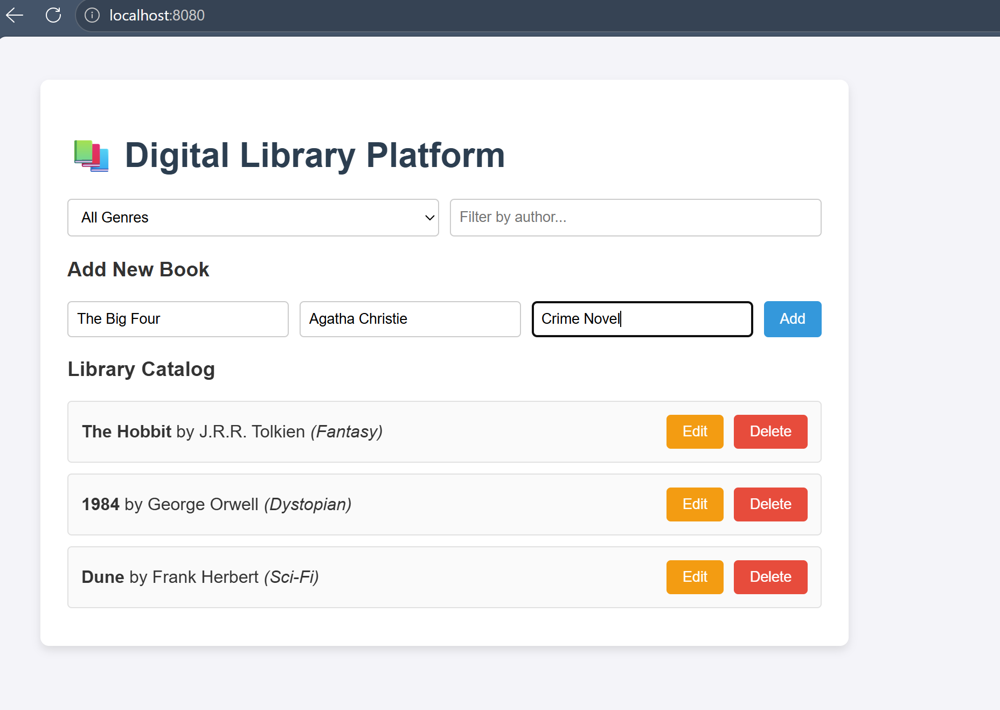
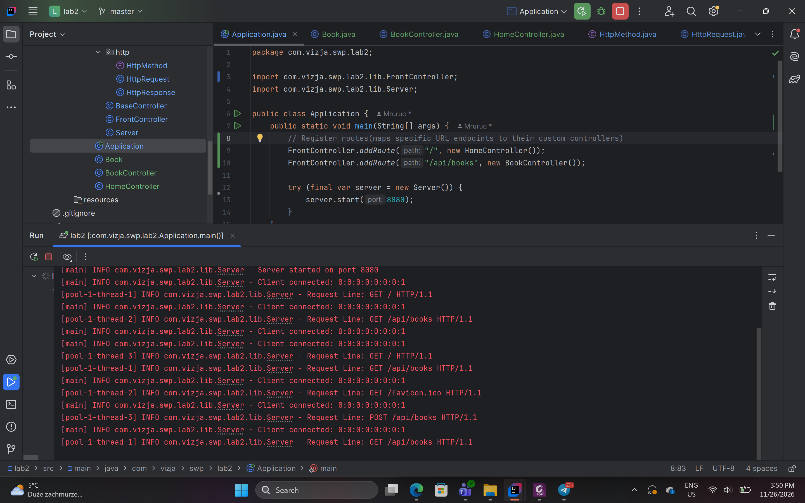

# Digital Library Web Application

A Java web application that implements a digital library catalog to demonstrate HTTP request methods (`GET`, `POST`, `PUT`, `DELETE`) and client-server data exchange[cite: 21, 24].

## What It Does
* **REST API (`BookController`):** Handles creating, reading, updating, and deleting books via JSON payloads over `/api/books`.
* **Interactive Web Interface (`HomeController`):** Provides a browser UI using asynchronous `fetch` calls to add, edit, delete, and filter books by genre or author.

## Screenshots
<table>
  <tr>
    <td align="center">
      <b>Triggering GET and POST</b> 
      
    </td>
    <td align="center">
      <b>GET and POST Results</b> 
      
    </td>
  </tr>
  <tr>
    <td align="center">
      <b>HTTP PUT Method</b> 
      
    </td>
    <td align="center">
      <b>Editing Triggering PUT</b> 
      
    </td>
  </tr>
  <tr>
    <td align="center" colspan="2">
      <b>HTTP DELETE Method</b> 
      
    </td>
  </tr>
</table>

## How to Run
1. Open the project in IntelliJ IDEA and run `Application.java` (starts the server on port `8080`)[cite: 22].
2. Open `http://localhost:8080` in your browser.

